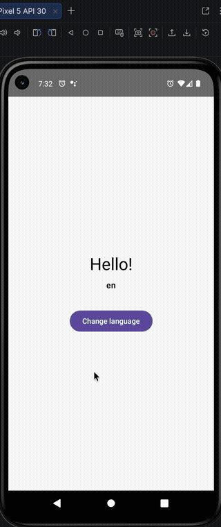
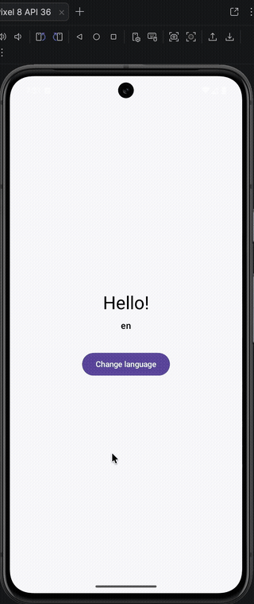
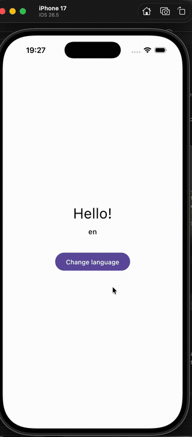

# KLocale

[](https://central.sonatype.com/artifact/io.github.nowjordanhappy/klocale)
[](LICENSE)
[](https://kotlinlang.org)

Kotlin Multiplatform library for **in-app language switching** on Android and iOS.
No Compose dependency — exposes `StateFlow`s you consume however you like.

## Demo

| Android (API 30) | Android (API 36) | iOS |
|:---:|:---:|:---:|
|  |  |  |

## The problem

Every KMP project that needs in-app language switching reinvents the same glue code — and on Android the
usual answer (`AppCompatDelegate`) only works below Android 13 if every screen is an `AppCompatActivity`.
KLocale packages the platform calls behind one shared API, and on Android works with a plain
`ComponentActivity` (Compose apps) or with AppCompat, whichever the app uses.

## Installation

```kotlin
// build.gradle.kts
dependencies {
    // Compose / ComponentActivity apps (no AppCompat):
    implementation("io.github.nowjordanhappy:klocale:2.0.0")

    // …or apps whose Activities extend AppCompatActivity:
    implementation("io.github.nowjordanhappy:klocale-appcompat:2.0.0")
}
```

## Usage

```kotlin
val klocale = KLocale(
    supported = listOf("en", "es", "pt-BR", "fr", "it"),
    fallback = "en",
    onChanged = { code -> /* optional: analytics, etc. */ },
)
// AppCompat apps: KLocale.appCompat(supported = …, fallback = …)

klocale.current         // StateFlow<String>  — the language in effect ("pt-BR", or the phone's mapped to `supported`)
klocale.chosen          // StateFlow<String?> — the one picked in the app, or null while following the phone
klocale.set("es")       // pick a language
klocale.followSystem()  // go back to the phone's language
klocale.getSystemDefault()  // the phone's language mapped to `supported` ("fr-CA" → "fr", "pt" → "pt-BR")

languageName("pt-BR")   // "Português (Brasil)" — each language named in its own language, for a picker
```

KLocale keeps the choice itself (the system on Android 13+, its own storage below and on iOS): nothing to
persist on your side.

## Android setup

### Two modes

| | `klocale` (platform mode) | `klocale-appcompat` |
|---|---|---|
| Your Activity | `ComponentActivity` (or anything) | `AppCompatActivity` |
| Android 13+ | System per-app language (`LocaleManager`) | Same |
| Android 5–12 | Stored by KLocale, applied by `KLocale.wrap` | AppCompat's backport, stored by its manifest service (shipped in the artifact) |
| Code in your Activity | `attachBaseContext` (below) | Nothing |
| Pulls in AppCompat | No | Yes |

### Platform mode: one override per Activity

```kotlin
class MainActivity : ComponentActivity() {
    override fun attachBaseContext(newBase: Context) {
        super.attachBaseContext(KLocale.wrap(newBase))   // applies the pick below Android 13; no-op from 13
    }
}
```

After `set()` / `followSystem()` the screens are rebuilt in the new language — by the system on 13+, by KLocale
below (it recreates the running activities, the same path as a rotation: ViewModels and saved state survive).
No Context to pass: KLocale picks up the application Context through a small, non-exported initialization
provider.

`wrap` also sets the JVM default locale (`Locale.getDefault()`), so **Compose Multiplatform resources**
(`composeResources`) and number/date formatting follow the pick below 13 too, not just Android resources.
Following the phone puts the phone's locale back.

Limits below Android 13 (they hold for AppCompat's backport too):
- an Activity that handles configuration changes itself (`configChanges`) isn't recreated, so `wrap` doesn't re-run;
- a WebView resets the locale;
- text built from the application Context (notifications, widgets) needs `KLocale.localizedContext(context)`.

### Settings: the system screen on 13+, your list below

```kotlin
if (!klocale.openSystemScreen(activity)) showLanguageList()   // false below 13, or if an OEM stripped the screen
```

Never fall back to the phone-wide language screen (`ACTION_LOCALE_SETTINGS`): it changes every app.

### Manifest — list your languages for the system screen

Let AGP generate it (AGP 8.1+):

```kotlin
android { androidResources { generateLocaleConfig = true } }   // plus res/resources.properties: unqualifiedResLocale=en
```

or write `res/xml/locale_config.xml` by hand and set `android:localeConfig="@xml/locale_config"` on `<application>`.
Without it the library still works, but the app won't appear in **Settings → Apps → [App] → Language** on 13+.

## iOS setup

### 1. Info.plist — enable the language picker in Settings

```xml
<key>CFBundleLocalizations</key>
<array>
    <string>es</string>
    <string>en</string>
    <string>pt</string>
    <string>fr</string>
    <string>it</string>
</array>
```

### 2. Behavior

`set()` writes `AppleLanguages` to the app's `NSUserDefaults` and updates `current` immediately; the system
applies it on the **next app launch** (standard iOS behavior). `followSystem()` removes it.

## Migrating from 1.x

- **AppCompat apps:** depend on `klocale-appcompat` and build with `KLocale.appCompat(…)`. Delete your own
  `AppLocalesMetadataHolderService` entry (the artifact ships it) and any "follow the phone" workaround
  (use `followSystem()`).
- **ComponentActivity apps:** keep `klocale` and add the `attachBaseContext` override. A language AppCompat had
  stored below 13 is read once and kept.
- `getSystemLanguage()` / `syncToSystem()` are gone: use `getSystemDefault()`, `set()` and `followSystem()`.
- iOS: a language picked with 1.x isn't reported as `chosen` (1.x didn't record it); the app keeps showing it.

## Requirements

| Platform | Minimum |
|---|---|
| Android | API 21 |
| iOS | iOS 13 |
| Kotlin | 2.1+ |

## License

[MIT](LICENSE)
